# QualityTraceability
农副产品销售与质量追溯一体化系统 
亮点：ECharts多维数据分析、销售与质量追溯一体化、二维码溯源查询、阈值区间判定与自动预警、随机抽查算法、企业信用评分算法、 Jieba中文分词与词频统计、批次库存与订单关联、分步采集向导、超时订单自动处理、监管处理闭环；
角色：管理部门、企业、消费者；

所有源码均本人开发，项目是前后端分离的，所有的项目都具备了完整的业务逻辑，不仅仅局限于基础的增删改查（CRUD）操作，系统亮点众多。

本文注重于计算机毕业设计选题指导，列出题目均有源码， 大家可以去【公众号】(毕业终点站)获取或者加我【qq】(2112698948)提意见(别忘记Star哟)。备注：git

声明：仅用于学习使用，请勿用于任何商业行为！

1.系统非商用，非开源，非无偿。

2.由本人开发，如需源码，请联系以下方式，qq:2112698948。

3.项目有很多，并未全部上传，如果未找到想要的，可直接咨询。

# 农副产品销售与质量追溯一体化系统

> 玉米质量追溯平台 · B/S 前后端分离 · 管理部门 / 企业 / 消费者三角色
>
> Spring Boot 3.3.1 + Vue 3 + MyBatis-Plus + ECharts + Jieba 中文分词

一套围绕玉米及农副产品搭建的销售与质量追溯平台：企业维护产品、批次与种植/加工/物流采集记录，发货时为订单分配批次并扣减库存；消费者在商城下单后，凭追溯码或二维码查看从田间到餐桌的完整链路；管理部门负责企业审核、质量阈值预警、监管抽查与不合格下架。三个角色共用一套数据，销售记录能追到具体生产批次。

---

## 一、技术栈

| 层次 | 选型 |
| :--- | :--- |
| 架构 | B/S、MVC、前后端分离、三角色权限管理 |
| 运行环境 | Windows |
| 开发工具 | IDEA、JDK 17、Maven、MySQL、Node.js |
| 后端 | Java、Spring Boot 3.3.1、Spring MVC、MyBatis-Plus、MySQL、JWT、Spring 定时任务、AOP、Apache POI、Jieba 中文分词 |
| 前端 | Vue 3、Vite、Element Plus、Vue Router、Pinia、Axios、ECharts、echarts-wordcloud、QRCode、jsQR |

## 二、角色与数据范围

| 角色 | 主要使用范围 |
| :--- | :--- |
| 消费者 | 浏览上架商品，按分类、关键词、产地筛选；管理购物车与收货地址，下单、支付、确认收货、申请退款；扫码或输入追溯码查询；提交评价与质量投诉 |
| 企业 | 提交营业执照与资质材料；维护本企业产品、批次、种植/加工/物流记录与追溯码；处理销售订单、发货批次分配；回复评价、处理投诉与质量预警 |
| 管理部门 | 维护用户、企业、产品分类、公告和质量阈值；审核企业资质；发起监管抽查、录入检验结果、导出监管报表；查看质量报警与投诉处理进度、平台运营统计 |
| 数据范围 | 消费者仅管理本人订单、地址、评价和投诉；企业仅管理本企业业务数据；管理部门可查看和处理平台全局数据 |

登录后服务端签发携带用户编号与角色信息的 JWT，前端把令牌放进 `Authorization` 请求头，拦截器解析后写入当前用户上下文；路由守卫再按角色限制后台与前台页面访问。

## 三、功能亮点

- **销售与追溯一体化**：商品、订单、批次与种植/加工/物流记录互相关联，发货时把订单明细绑定到具体批次，销售记录可以反查生产批次。
- **二维码溯源查询**：QRCode 生成批次追溯码二维码，jsQR 识别上传的二维码图片，也支持手动输入追溯码；结果页集中展示产品来源、流转记录和质量异常。
- **阈值区间判定与自动预警**：按已启用的上下限配置，定时任务每 10 分钟比对种植与加工指标，超限时生成报警并避免重复记录。
- **随机抽查算法**：随机打乱企业及批次列表，按指定企业数量与批次数生成抽查记录，减少逐条勾选。
- **企业信用评分**：按「质检合格率 × 70 ＋（1 − 投诉率）× 30」计算 0～100 分，映射为 A/B/C/D 等级。
- **Jieba 分词与词频统计**：对评价文本分词并生成词云数据，结合评价与投诉统计定位消费者关注的问题。
- **批次库存与订单关联**：发货时校验批次分配数量与库存，扣减批次库存并写入库存变动日志。
- **分步采集向导**：把批次创建、追溯码生成、种植/加工/物流记录录入串成一条流程，企业按步骤补齐批次档案。
- **监管处置全流程**：从抽查记录、检验结果录入、监管报表导出到不合格产品下架，把质量发现与后续处置连起来。
- **超时订单自动处理**：订单创建后设 30 分钟支付截止时间，定时任务每 10 秒检查，超时未支付自动取消。
- **ECharts 多维分析**：管理部门看销售趋势、热销排行、扫码热度；企业看本企业产品、订单、销售、追溯码与预警概览。

---

## 四、界面展示

> 说明：源文档首图为三角色登录页，未提供独立的系统总览图，故「登录入口」单独成节，首图不充当总览横幅。全部截图均为桌面网页，按模块分区排布。

### 4.1 登录入口

三个角色（管理部门 / 企业 / 消费者）共用同一登录页，左侧为平台介绍与品牌标语，右侧登录卡支持角色切换、账号密码与图形验证码，并提供忘记密码与新账号注册入口。

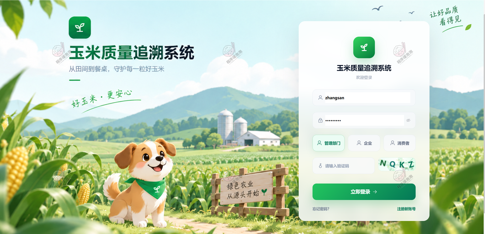

### 4.2 消费者端（玉米优选商城）

**商城首页**
顶部导航含首页、所有分类、质量追溯、我的订单与购物车；首屏横幅主打「每一穗玉米都有自己的身份证明」，下方按玉米原粮、玉米淀粉、玉米油、玉米饲料、玉米深加工、玉米休闲食品分类，热销单品卡片带「促销」「可追溯」标签。

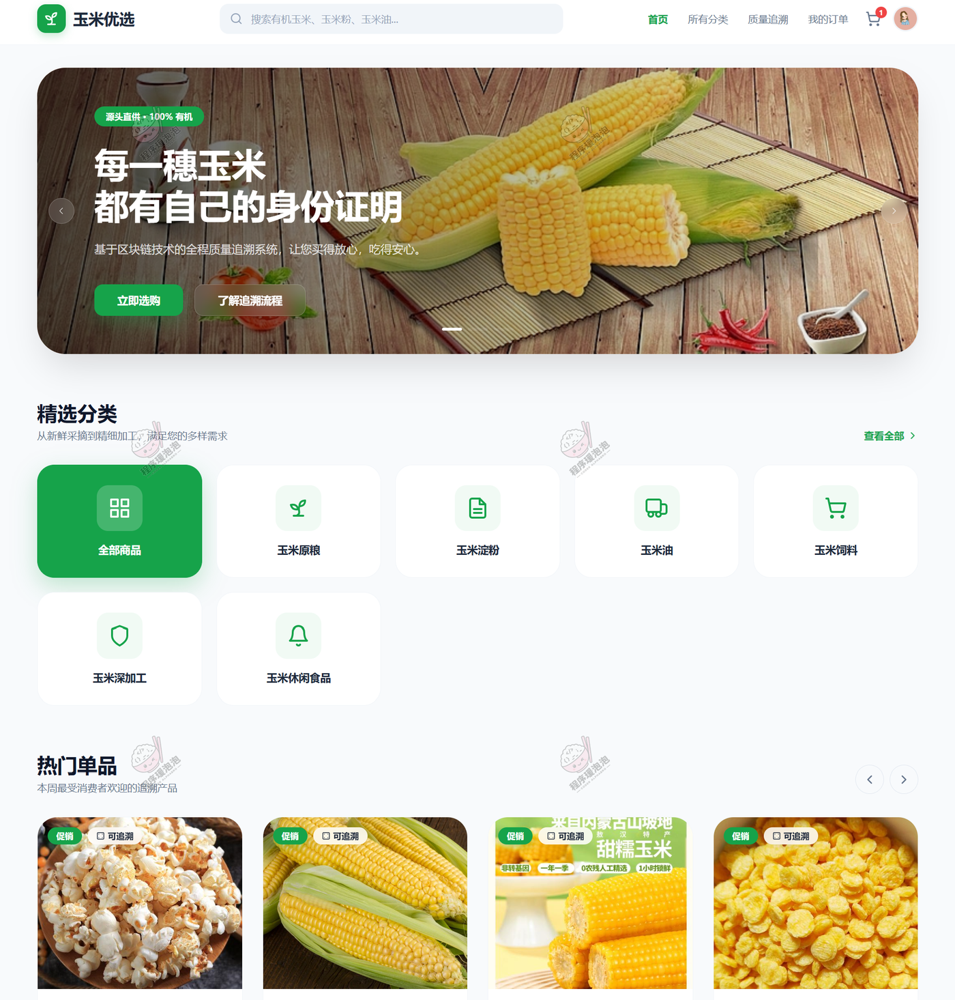

**全部商品**
分类标签可切换，右侧支持按商品名称/产地搜索、选择产地与排序方式；商品卡显示促销价与划线原价，并标注所属企业与产地。

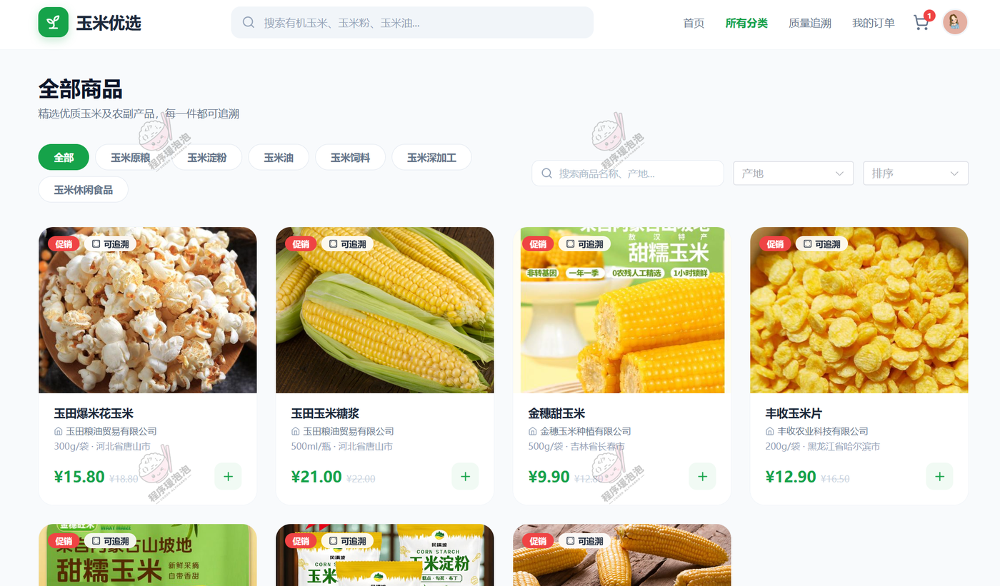

**商品详情**
以爆米花玉米为例：售价 ¥15.80（原价 ¥18.80，促销中），规格 300g/袋、产地河北省唐山市、生产日期 2026-09-15、保质期 365 天、生产企业玉田粮油贸易有限公司，库存 3979、总销量与近 30 天销量均为 21；下方展示商品评价与企业回复。

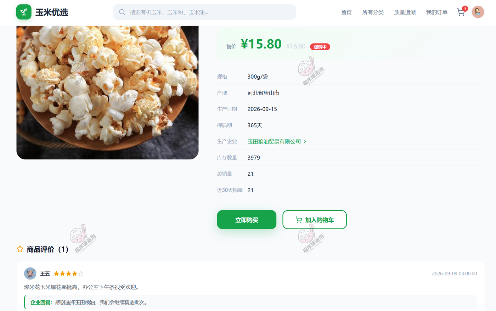

**产品质量追溯**
支持输入追溯码查询，或点击/拖拽上传二维码图片识别（JPG、PNG 等格式），进入后查看从田间到餐桌的完整溯源链路。

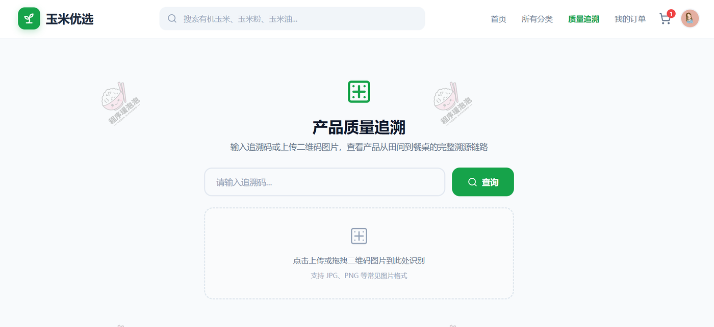

**我的订单**
按全部、待支付、已支付、已发货、已收货、已退款、已取消、已完成分状态查看；订单卡片展示商品明细、金额、收货人脱敏信息，以及「已支付 → 已发货 → 已收货」的时间节点，底部提供申请退款、评价、投诉入口。

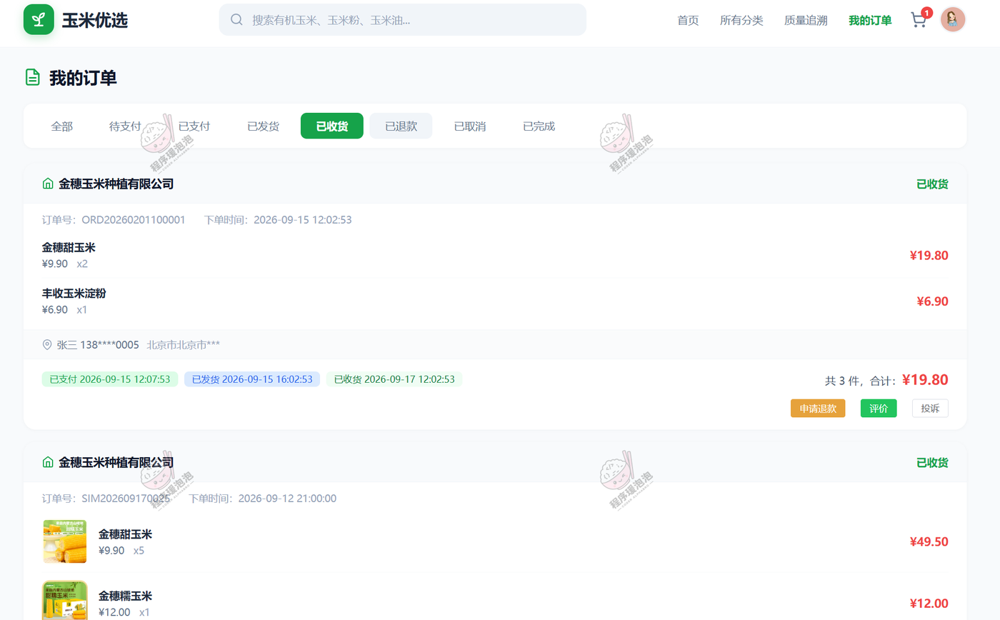

**我的评价**
列出已评价商品与星级，按时间倒序排列，每条下方显示企业回复内容与回复时间；右上角下拉可进入个人中心、我的订单、收货地址、我的投诉。

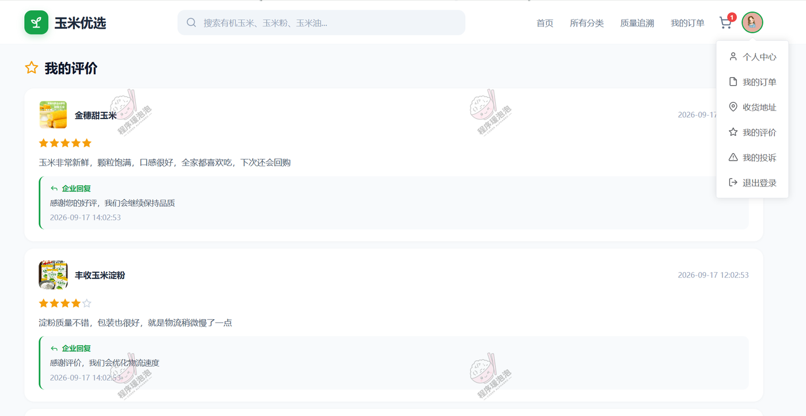

### 4.3 企业端（管理控制台）

**企业管理中心**
十项经营指标一屏概览：我的产品 3、上架中 2、产品批次 3、订单总量 19、待发货 2、总销售额 368.50 元、追溯码 3、扫码次数 16、投诉数 3、未处理报警 1；下方是近 30 天订单与销售趋势折线图、产品分类分布环形图。左侧菜单覆盖产品管理、追溯管理、销售管理、质量管理、评价管理。

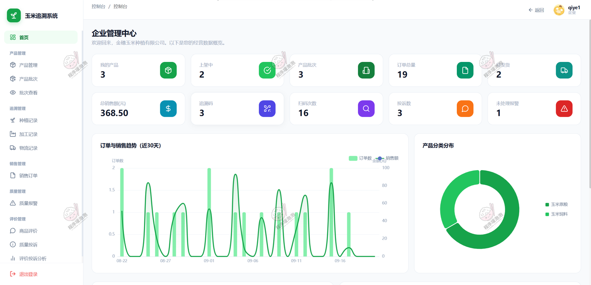

**产品管理**
支持关键词、产品分类、生产日期、是否上架组合筛选；列表展示规格、产地、生产日期、保质期、售价与促销价、产品图片、产品详情、上架状态，可新增、编辑、删除（含批量删除）。

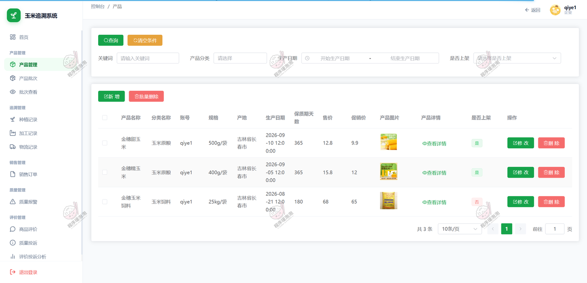

**批次查看**
左侧为产品批次列表（金穗甜玉米 5965 件 / 4996 件、金穗糯玉米 2987 件）及搜索框；右侧以标签页汇集产品信息、种植记录、加工记录、物流记录、追溯码、库存变动、监管抽查。当前种植记录显示 A 区 1 号地块—甜玉米—金甜 168，土壤 pH 6.2、温度 28.5℃、湿度 75%，因湿度超出正常范围被标记为「异常」。

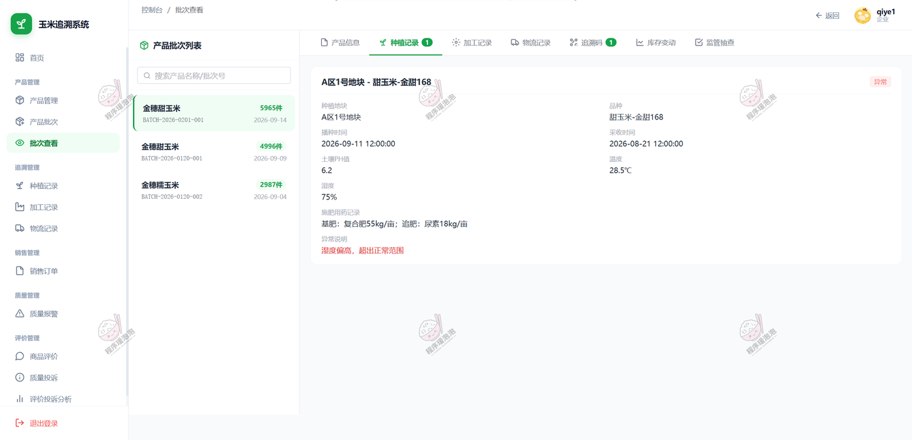

**种植记录**
按批次号、账号、地块、品种、播种时间、施肥用药记录、采收时间、土壤 pH、温度、湿度、是否异常逐条管理；筛选条件含关键词、所属批次、播种/采收时间、是否异常。异常行（pH 6.2、28.5℃、75%）以红色标出。

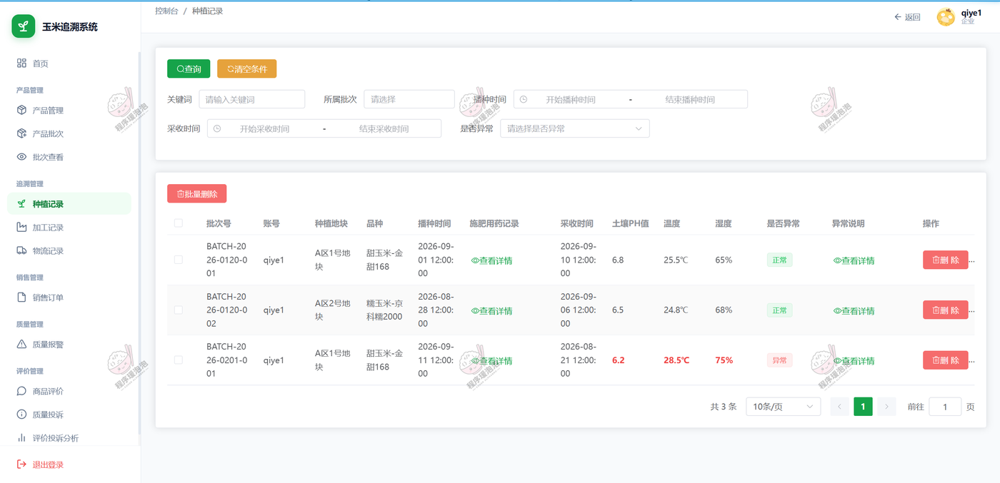

**销售订单**
顶部四项统计：总订单数 19、总销售额 ¥658.90、总销量 63、待发货 2；列表含订单号、消费者、订单总额、实付金额、收货人、联系电话、收货地址、订单状态，可按关键词、订单状态、支付时间筛选，支持发货、同意退款、删除。

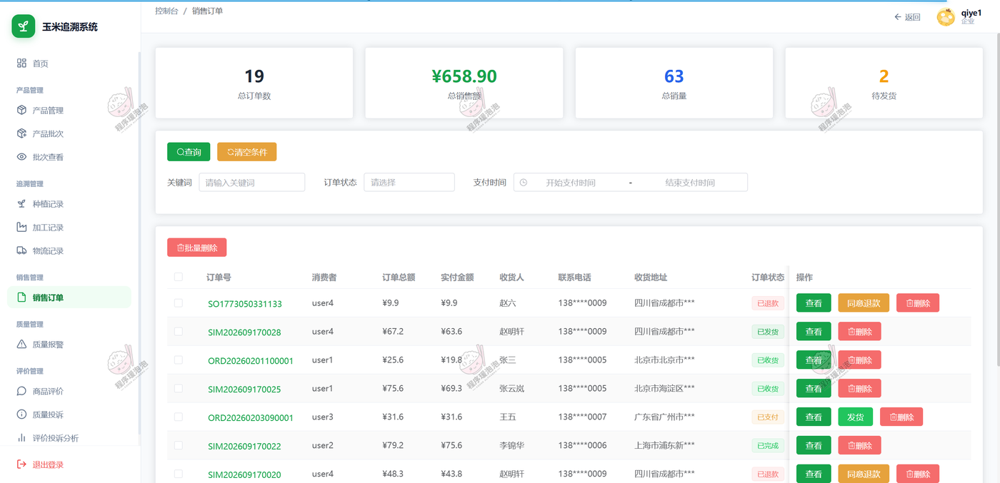

**商品评价**
按消费者、商品图片、商品名称、订单号、评分、评价内容、企业回复、回复时间列出本企业商品的评价，可查看详情、修改回复或对未回复项新增回复。

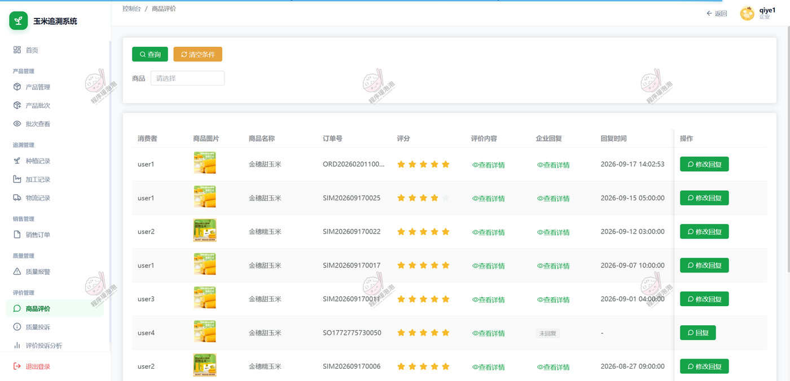

**质量投诉**
企业侧投诉列表展示消费者、商品、订单号、投诉内容、投诉图片、投诉状态（已回复 / 待处理 / 已关闭）、企业回复与投诉时间，可回复、查看回复、删除。

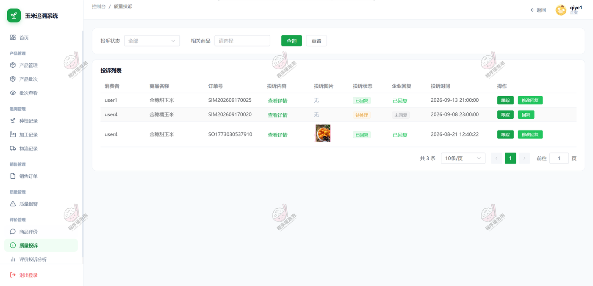

### 4.4 管理部门端（监管控制台）

**企业审核列表**
按企业名称与审核状态筛选，列出企业名称、账号、联系人、手机号、审核状态、提交时间，可进入详情查看营业执照与资质材料并执行通过或驳回；示例数据中金穗玉米、丰收农业、绿源食品、玉田粮油四家企业均已在列。

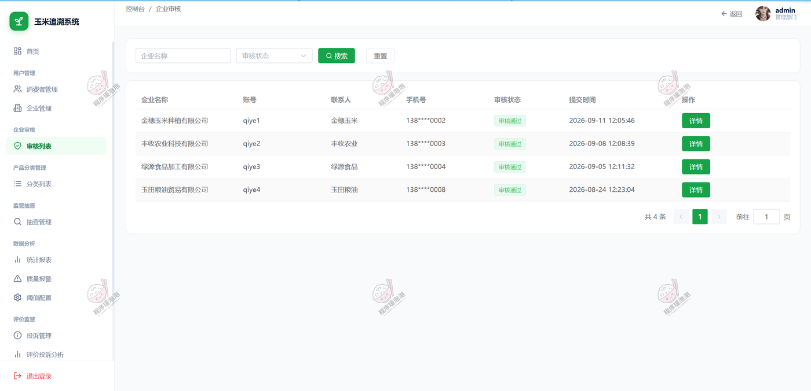

**监管抽查记录**
支持批量抽查、企业信用评级、导出与批量删除；列表含商品图片、商品名称、企业、批次号、批次数量、检查人、检查时间、检查结果，可录入检验结果。示例中已出现「水分含量 13.5% 未…」「杂质率 1.2% 超标」等检验结论，其余为待检验。

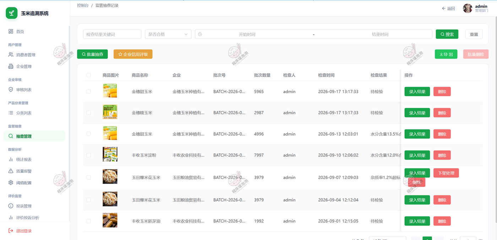

**统计报表**
近 30 天销售趋势（订单数 + 销售额双轴折线）、热销产品 Top10 条形图、追溯码扫码排行横向条形图三块并排，用于查看销量走势、热销商品与扫码热度。

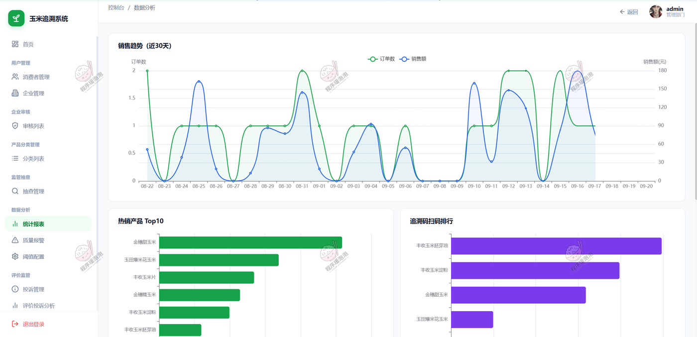

**阈值配置**
质量报警阈值按「配置名称 / 检测字段 / 报警来源 / 阈值下限 / 阈值上限 / 单位 / 启用状态」维护：土壤 pH 5.50～8.00、种植温度 10～35℃、种植湿度 30～90%（种植环节）；水分含量 0～14%、杂质率 0～1%、霉变率 0～2%、黄曲霉毒素含量 0～20 μg/kg（加工环节），每项可单独开关并保存。

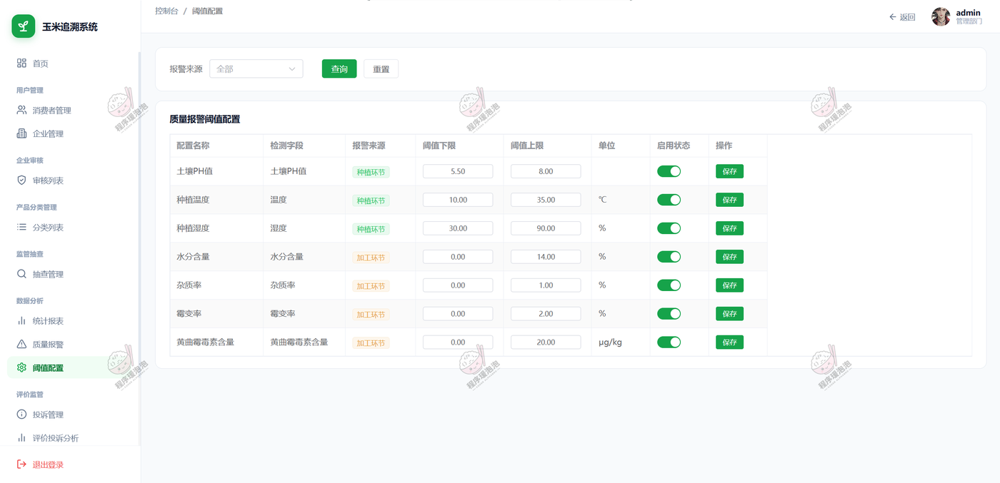

**投诉管理**
管理部门视角汇总全平台投诉：可按投诉状态、相关商品、消费者、被投诉企业筛选，列表额外带「被投诉企业」列，展示已关闭 / 已回复 / 待处理状态及企业回复时间，共 7 条，其中 2 条仍为待处理，可回复、关闭、删除。

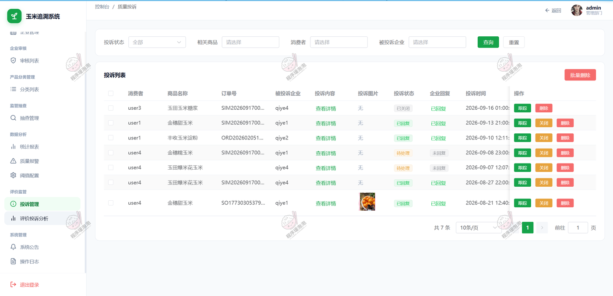

---

## 五、核心实现说明

**1. 三角色账号体系与数据隔离**
账号分管理部门、企业、消费者三类。登录后签发含用户编号与角色的 JWT，前端请求统一带 `Authorization`，服务端拦截器解析并写入用户上下文；业务查询再按本人、本企业或全局范围收敛，避免越权读取。

**2. 企业资质审核与产品建档**
企业提交营业执照和资质材料后进入待审核状态，管理部门按待审核、通过、驳回处理并记录审核意见。审核通过的企业按玉米原粮、玉米淀粉、玉米油、饲料等分类维护产品，录入规格、产地、生产日期、保质期、价格与促销价，并控制上下架。

**3. 批次串联种植、加工、物流与预警**
批次是追溯采集、追溯码生成、发货扣减的业务载体。种植记录保存地块、品种、播种采收时间、施肥用药、土壤 pH、温湿度；加工记录保存加工厂、工艺、质检报告、水分、杂质、霉变、黄曲霉毒素；物流记录保存运输方式、节点、温湿度与到达时间。定时任务每 10 分钟扫描启用阈值，超限即生成未处理预警并避免重复写入。

**4. 追溯码生成与全链路查询**
每个批次可生成唯一追溯码，码值按「TC-PC-批次编号-时间戳-随机码」构成并保存独立密钥，同一批次不重复生成。消费者输入或扫描后，服务端按批次加载产品、企业、种植、加工、物流与质量预警，累加扫码次数后返回；结果页按时间线展示，存在预警时突出提示。

**5. 下单、支付与发货批次分配**
提交订单时读取购物车选中商品，取促销价或销售价计算金额，保存商品名称、图片、单价、数量快照，并复制收货人、电话、地址到订单。订单默认待支付并设 30 分钟截止时间，定时任务每 10 秒检查超时取消；支付成功后企业发货时必须为订单明细分配可用批次，校验数量一致与库存充足后扣减批次库存并写库存变动日志。

**6. 评价投诉与企业信用评级**
评价与投诉均关联消费者、企业、产品与订单，保存评分/内容/图片、企业回复与时间。企业只能看到本企业相关数据，管理部门可看全平台处理进度。信用评分按抽查合格率与投诉率加权计算，限制在 0～100 分并映射 A/B/C/D 等级。

**7. 监管抽查与不合格处置**
管理部门可按选定追溯码批量创建抽查任务，也可随机抽取企业与批次；抽查记录关联追溯码、批次、检查人、检查时间、检验结果与合格标识，支持导出 Excel。不合格时依据追溯码定位产品并设为下架，同时写入监管抽查来源的质量预警，在预警与监管列表持续跟踪。

**8. 运营分析与操作留痕**
管理部门看板汇总用户、企业、产品、订单、追溯码、扫码次数、未处理预警、投诉与销售额；统计模块提供近 30 天订单量与销售额趋势、热销商品排行、产品扫码排行与追溯码类型分布，前端用 ECharts 呈现。关键写操作通过 AOP 记录操作用户、类型、内容、IP 与时间。

---

## 六、说明

- 系统为三角色单平台结构，消费者端为商城前台，企业端与管理部门端共用同一后台框架，通过角色与菜单权限区分。
- 源文档对「阀值设置」的表述，界面实际文案为「阈值配置」，本文按界面写法统一为「阈值」。
- 部分截图数据为演示数据（不同截图采集时点不同，统计口径可能有差异），指标以各截图自身显示为准。

> 文档展示 19 张截图，需要了解更多，请联系我。
